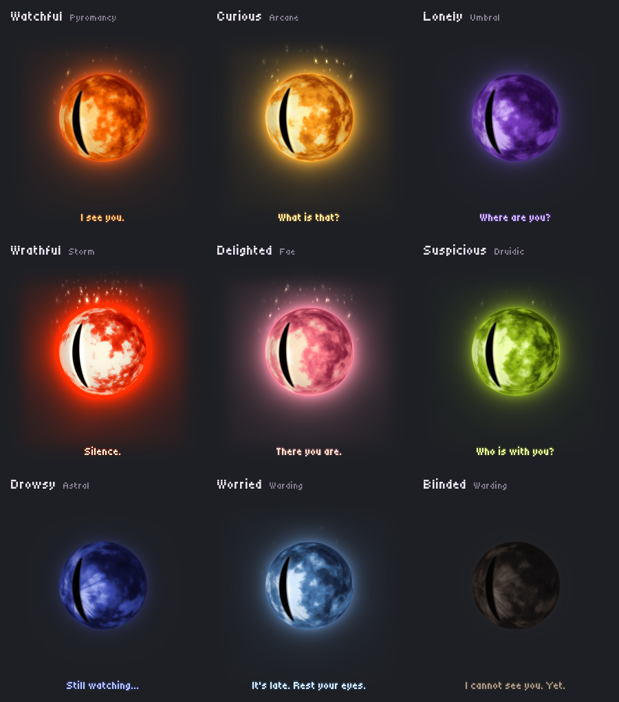
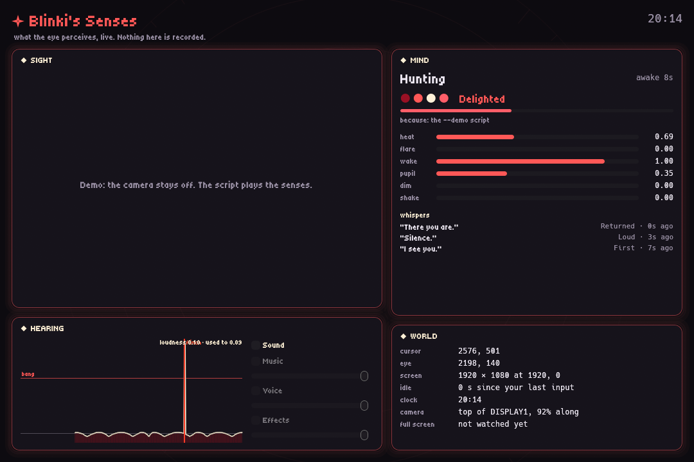
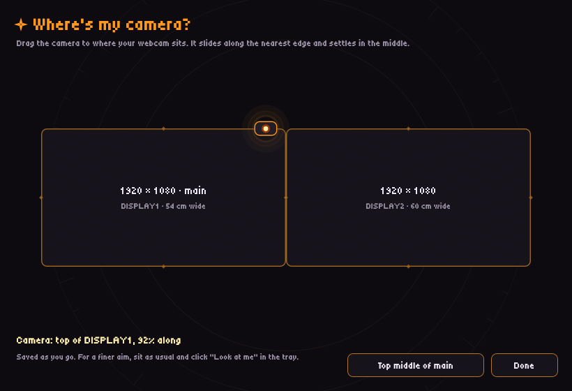

<p align="center">
  
</p>

<h1 align="center">Unblinking</h1>

<p align="center"><b>A small magical eye that lives on your desktop, finds your face, and watches.</b><br>
Native Rust, one 27 MB exe. It runs entirely on your computer and never goes online.<br>
<sub>Version 0.2.0 · <a href="CHANGELOG.md">changelog</a></sub></p>

---

Unblinking puts a living eye in a corner of your screen. It sees you through your webcam with an on-device face detector, hears the room through your mic, and reacts. It locks on when you sit down, hunts when you leave, flinches at a bang, and whispers. Its mood shifts all the time, and each mood draws on its own school of magic.

The GIF above is the app itself: `--demo` plays a scripted 14 seconds and `--record` writes the frames it really draws, with no screen capture.

## Nine moods, nine schools of magic

<p align="center"></p>

Each mood sets the fire's colours, its swirl, glow and embers, and how its whispers enter. Pyromancy rises out of the heat, Arcane turns in like runes, Umbral condenses out of smoke, Storm crackles on, Fae gathers from sparks, Druidic grows up from the ground, Astral fades in like starlight, and Warding is etched on. Moods melt into each other over 1.4 seconds.

| It notices | It does |
| --- | --- |
| Your face | Locks on: the pupil narrows to a slit and aims at your eyes, from wherever the eye sits on screen |
| You leave | It hunts, follows your cursor, and grows lonely. "Where are you?" |
| You come back | It lights up. "There you are." |
| A bang | It flinches, shakes and flares red. "Silence." |
| Two people | It looks from one to the other, suspicious. "Who is with you?" |
| Late, and quiet | It gets drowsy. Very late, it worries and tells you to rest, at most twice an hour. |
| You smile (if you let it read your face) | It's delighted |

It also keeps **Remembrance**: a small, private ledger of your good days together (breaks taken, rest, coming back, smiling). This slowly shapes its temperament. It's glad about what's good for you, never about time spent staring at it. Turn it off, or forget everything, from the menu.

## Blinki's Senses

<p align="center"></p>

A window that shows what the eye perceives, styled as a scrying glass. **Sight** shows the live camera picture with every face box, the five landmarks, the face it's watching and the ones it ignores, and a gaze dial. **Hearing** shows loudness over time with the bang line, every flinch, and the Sound mixer. **Mind** shows its mode, its mood and why it chose it, and its whispers. **World** shows where everything is. Open it from the tray or with Ctrl+Alt+B. (Above, `--demo` mode, so the camera is off.)

## Where's my camera?

<p align="center"></p>

The eye sees you from the camera's spot but looks at you from its own, so it needs to know where the camera sits. This window draws your monitors as they're really arranged. Drag the camera to its spot along any edge, and it snaps gently to the middle. The eye then works out where your eyes are in the room (from how wide your face looks) and aims straight at them. "Look at me" in the tray fine-tunes it.

## Features

- **A transparent, always-on-top eye**: frameless, off the taskbar, drag it anywhere, and it remembers the spot. It eases open, and fades away when it hides or quits.
- **On-device face tracking**: YuNet in pure Rust, about 15 looks a second, aimed with real geometry at your eyes.
- **Hearing**: the mic becomes one loudness number that feeds the flames and makes it flinch.
- **Whispers** under the eye in the Tiny5 pixel font, spoken aloud if you like by Windows' own local voice.
- **A sound mixer**: Music (a live-synthesised drone), Voice, and Effects (a deep whoomp at a bang, a chime with each whisper), each with its own switch and volume, under one master.
- **Themes, feelings and Remembrance**, as above. Reading your expression is opt-in and off by default.
- **A tray menu** (also on right-click of the eye): hide, blind, whispers, Sound, click-through, hide when something's full screen, the wake word, start with the computer, Theme, Read my face, Remember our days, Forget our days, Blinki's Senses, Where's my camera?, Look at me, Banish.
- **It gets out of the way.** Start a full-screen game, video or presentation, and it closes and hides, then fades back in, pouting, when you return.
- **"Hey, OG Blinki"**: an opt-in wake word, matched on the computer by Windows' own speech recognizer, with no cloud. Off by default.
- **One copy at a time.** Launching it again just wakes the eye.
- **A per-user installer** with a Start menu shortcut and an uninstaller.

## Privacy

- **It never goes online.** The face models and the font are built into the exe. There's nothing to download, ever.
- **Nothing is recorded.** Camera frames are looked at and dropped. The mic becomes one loudness number. Blinki's Senses shows the camera picture live only while it's open, and saves nothing.
- **Blind it** from the menu and the camera and mic are released, not just ignored.
- **Reading your face is opt-in**, off by default, and stays in memory.
- **Remembrance** keeps counts of good deeds (never keys, never pictures) in a small file on your computer. "Forget our days" erases it.

## Size and memory

Measured on this PC (Windows 11, RTX 3060), with both apps idle and blinded, against the Electron version this replaces:

| | Electron | Rust |
| --- | --- | --- |
| What ships | 356.8 MB runtime + 0.5 MB of app | one exe, models and font inside (22.3 MB as measured; 27.5 MB now, with the 4.8 MB expression model and the new sphere) |
| Installer | (none) | 7.6 MB setup |
| Processes | 5 | 1 |
| Working set | 448.7 MB | 134.9 MB |
| Private memory | 231.4 MB | 147.9 MB |
| Face detection | MediaPipe in WebAssembly | 23.6 ms per 1280x720 frame on the CPU |

## Under the hood

- **Rust** throughout, 168 tests (`cargo test`), checked on Windows CI with clippy and formatting, with the Electron code kept for reference until the switch-over.
- **winit 0.30 + wgpu 30.** The eye is one fragment shader. For a transparent window on Windows, DX12 presents through a **DirectComposition** swapchain with **premultiplied alpha** (a plain swapchain can't be see-through), with Vulkan as a fallback. A transparent first frame means it never flashes a black box.
- **The shader** is GLSL, compiled for DX12 or Vulkan by **naga**. The body is raymarched: a signed-distance sphere with layered fire inside, a hotter core seen through its veins, and a solid pupil. Around it sits a layered aura: rim bloom, halo, corona, tongues of light and curling embers. A small motion layer gives the mind's wishes a body (breath, gaze velocity, a wince). Frame pacing keeps it light when nothing's changing.
- **Face detection**: YuNet (ONNX), run by **tract**, a pure-Rust inference engine, on its own camera thread (**nokhwa**). The box decoding and non-maximum suppression are written by hand.
- **Sound**: **cpal** streams in both directions. The drone and the effects are synthesised sample by sample in the audio callback, without allocating, steered through atomics. Speech uses the system voice via **tts**.
- **egui** (on the same wgpu device) draws the whispers, Blinki's Senses and the camera picker. **tray-icon + muda** do the menu, **global-hotkey** the shortcut, and **serde** the prefs (shared with the Electron app's `prefs.json`).
- **Size**: LTO, stripped, size-optimised everywhere except the face model's runtime. Asking wgpu for small GPU memory blocks saved about 180 MB.

## Run it

Needs [Rust](https://rustup.rs) (stable, MSVC) on Windows.

```bash
cd rust
cargo run --release
```

Or build the installer: [rust/README.md](rust/README.md#build-the-installer).

| Flag | What it does |
| --- | --- |
| `--demo` | A scripted 14 s performance: moods, whispers, a flinch, no camera or mic |
| `--record=FILE.gif` | Saves the frames it draws as a GIF (used for the one above) |
| `--senses`, `--camera` | Opens Blinki's Senses or Where's my camera? at start |
| `--mood=NAME`, `--whisper=TEXT` | Holds a mood, or shows a whisper |
| `--snap=MS` | Saves one frame to `snap.png` after MS milliseconds |
| `--blind`, `--voice` | Blinded, or all sound on, for this run only |
| `--bench-face` | Times the face model |

More detail, including a module map: [rust/README.md](rust/README.md).

The original Electron version (`npm install`, `npm run setup`, `npm start`) still lives in `src/` and `renderer/` until the switch-over.

## Versioning

Unblinking follows [Semantic Versioning](https://semver.org). Before 1.0, a
minor bump (0.2 to 0.3) brings new features and a patch (0.2.0 to 0.2.1)
brings fixes. The version lives in `rust/Cargo.toml`. It's shown at the top
of the tray menu, names the installer (`unblinking_0.2.0_x64-setup.exe`) and
the CI build, and each release is tagged `vX.Y.Z`. `v0.1.0`, also tagged
`electron-final`, is the original Electron version. See
[CHANGELOG.md](CHANGELOG.md).

## Credits

- **YuNet** face detector, from [OpenCV Zoo](https://github.com/opencv/opencv_zoo/tree/main/models/face_detection_yunet). MIT, Shiqi Yu and contributors.
- **Facial expression recogniser** (MobileFaceNet), from [OpenCV Zoo](https://github.com/opencv/opencv_zoo/tree/main/models/facial_expression_recognition). Apache 2.0, the Shenzhen Institute of Artificial Intelligence and Robotics for Society and contributors.
- **Tiny5** font, by the Tiny5 Project Authors ([Gissio/font_Tiny5](https://github.com/Gissio/font_Tiny5)). SIL Open Font License 1.1.
- **Remembrance**, the idea that a companion should be fed by how well you're doing, comes from Lifesworn.
- Moods, colours and schools of magic were tuned in the Blinki Studio.

Licence texts are in [rust/assets](rust/assets).

## License

MIT. See [LICENSE](LICENSE).
